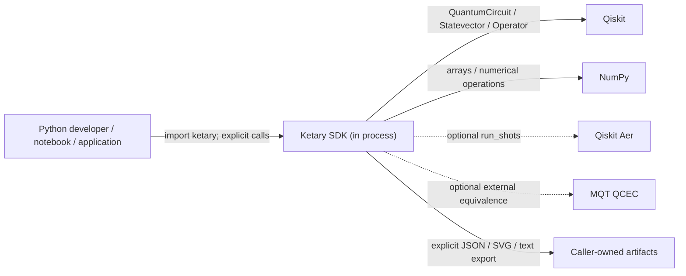
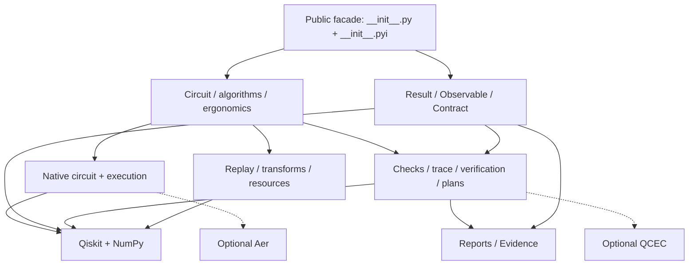
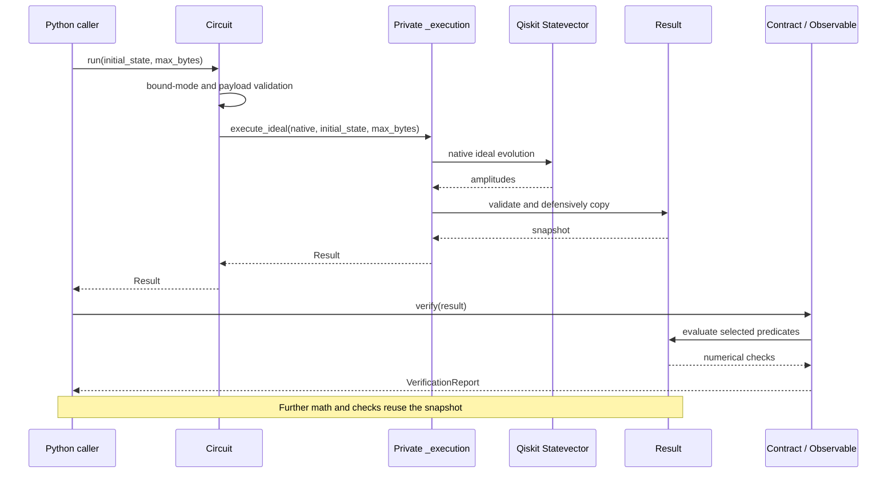

# Ketary architecture

Status: experimental Python 3.12 SDK, 0.1.0.dev0. Architecture baseline:
CORE01–CORE10, [PR #41](https://github.com/devfelipenunes/ketary/pull/41).
This document describes the implemented system; proposed refactoring is
explicitly distinguished from current boundaries.

## 1. Architectural style and rationale

Ketary is an in-process modular SDK, with a public facade and selective
ports-and-adapters-inspired boundaries. It is not a strictly backend-independent
hexagonal architecture. Qiskit's QuantumCircuit is the authoritative mutable
program. Qiskit Statevector and NumPy supply numerical execution and math.
No independent IR, second simulator, service, persistence store, or network
protocol is introduced.

The public API is a driving boundary for Python applications, notebooks,
tests and other libraries. Optional Aer and QCEC integrations are narrow
technology-specific boundaries. The native Qiskit dependency also appears
inside circuit, math, checking, replay, and transpilation modules. The private
_execution module owns ideal evolution after facade preflight; trace paths
share a monotonic native cursor. Dependency
inversion is selective, not universal. A generic execution backend is not
currently implemented.

## 2. Context (C4-inspired)

All library calls are local; QCEC can use a separate worker for its hard
timeout. The package does not host a service or store user artifacts.
C4 container/deployment diagrams for web systems would be misleading here:
the SDK is installed into the caller's Python environment.

## 3. Component view (logical responsibilities, not dependency inversion)

Arrows summarize interactions; this is not a claim that Python import
dependencies are acyclic. See [dependency boundaries](architecture-boundaries.md)
for the actual module map, direct imports and permitted local back-references.

## 4. Core objects and ownership

| Object | Owner / representation | Lifetime and behavior |
|---|---|---|
| Circuit | One native QuantumCircuit | Mutable builder; independent copy/transform results |
| Result | Defensive NumPy complex snapshot | Reusable ideal-state data; no hidden rerun |
| Observable | Frozen real Pauli terms and minimum width | Immutable expression; native conversion on demand |
| Contract | Frozen selected snapshot predicates | Reusable; width checked, explicit verification |
| ShotResult | Frozen empirical counts and measurement metadata | Separate dynamic execution result |
| Evidence | Bounded canonical JSON artifact with hash | Explicit reproduction; hash is not authentication |
| Reports | Frozen checks or legacy mutable dict subclasses | Explicit verdict and scope; no implicit execution |

Named wire selections and checkpoint labels are local annotations. Copy
preserves them; transformations and logical replay do not. A change in
global phase through apply can invalidate checkpoint labels. No persistent
second circuit state exists. Public native export returns an independent copy.

## 5. Execution and verification flow

Circuit comparison is a different path: selected product inputs and/or full
small operators, potentially yielding Evidence. No witness alone does not
establish equivalence. Explicit reproduction runs both saved circuits.
State fidelity, probability equality, strict operator equality and external
up-to-phase verification must not be conflated. Trace is zero-input and
opt-in; the first observed divergence is not necessarily the cause.

## 6. Runtime modes and boundaries

- Bound unitary: native ideal statevector; bounded logical replay, transforms,
  operator checks and tracing.
- Symbolic: native parameters; complete binding before bound-only operations.
  Sweep plans freeze explicitly bound circuits, execute only on run.
- Classical: one native classical register, restricted measurement/reset and
  conditionals; optional Aer returns ShotResult. Not interchangeable with
  Result, not accepted by logical unitary replay or transforms.
- Optional external QCEC: separate native equivalence relation and deadline;
  does not promote a result into Ketary strict-phase equivalence.

## 7. Quality attributes and limitations

Correctness: preserve native bit order, global phase and operator semantics;
compare complete operators where feasible. Use independent native/analytic
oracles and explicit unsupported states. Resource limits bound selected
payloads/work, not total process RSS. Data is caller-owned, replay is strict
bounded JSON, no pickle or dynamic evaluation. No hardware/noise execution,
automatic backend selection or generic synthesis. Import of the package does
not load Qiskit; native calls load required dependencies lazily.

Maintainability: private modules are not separate products. Public signature
parity, surface inventory, regression tests, packaging and optional-backend
jobs protect the interface. See [architecture boundaries](architecture-boundaries.md),
[core design](core-api.md), [compatibility](compatibility.md) and
[verification guide](verification-guide.md).

## 8. Architecture decisions

- [ADR 001 — Native authoritative representation](adr/001-native-representation.md)
- [ADR 002 — One facade, selective adapters](adr/002-selective-adapters.md)
- [ADR 003 — Explicit execution and numerical guarantees](adr/003-explicit-execution.md)
- [ADR 004 — Private execution and trace progression](adr/004-private-execution-and-trace.md)
- [ADR 005 — Call-local native Pauli query ownership](adr/005-pauli-query-ownership.md)

See [architecture progression](architecture-roadmap.md) for scaling and extension gates.

References: [Cockburn, Hexagonal Architecture](https://alistair.cockburn.us/hexagonal-architecture/),
[Simon Brown, C4 model](https://c4model.com/),
[Documenting architecture decisions](https://gds-way.digital.cabinet-office.gov.uk/standards/architecture-decisions.html).
The architecture is documented using these ideas, not claimed to implement
every aspect of either pattern.
